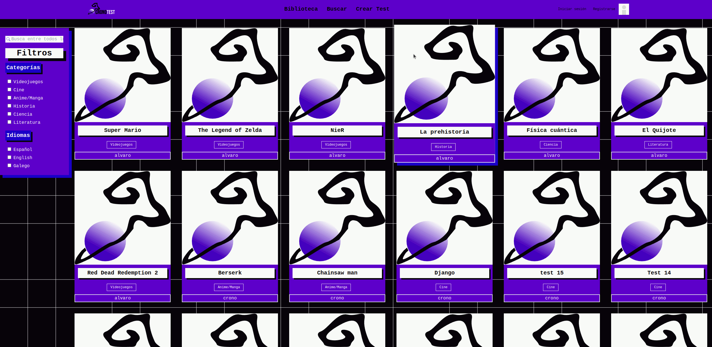

# Proyecto de fin de ciclo DAW

## Descripción

**Cronotest** es una web donde la gente puede subir y realizar tests. El funcionamiento es sencillo: los usuarios pueden crear tests personalizados que quedan guardados en la base de datos de la página.

Cualquier usuario puede realizar los tests que se encuentran en la base de datos. Además, se puede elegir entre realizar los tests con un límite de tiempo y puntuación, o de forma casual, con tiempo infinito y sin puntuaciones.

Para mejorar la experiencia, se pueden aplicar distintos filtros para buscar los tests. También se ofrece la opción de valorarlos para poder ver rápidamente la calidad de cada uno. Esta y más información se despliega en una pestaña nada más seleccionar un test.

Otro añadido es la biblioteca, la cual permite a cada usuario guardar los tests que más le gusten.

Todos los usuarios registrados tienen su propio perfil público en el cual se pueden ver los tests que hayan creado, junto con más información sobre el usuario.

Es necesario acceder como un usuario registrado para poder crear tests, tener un perfil propio, valorar y guardar los tests. Sin embargo, cualquier persona que entre en la web puede acceder al buscador para realizar los tests de la página, además de poder visualizar los perfiles del resto de usuarios.

En conclusión, el objetivo de Cronotest es reunir una gran variedad de tests, de cualquier temática y enfocados a diversos públicos, en un mismo lugar.

  

## Uso

Al entrar en Cronotest estarás en la página de inicio, la cUal explica en que consiste la web, una vez dentro verás en la barra de navegación dos menús, el principal y el de usuario. 

En el menú principal puedes acceder a los siguientes apartados:
- Biblioteca
- Buscar
- Crear Test

En el menú de usuario puedes acceder a estos otros:
- Iniciar sesión
- Registrarse
- Perfil
	- Cerrar sesión 
	- Editar el usuario
	- Panel de administrador (si eres administrador)
	- Acceder a los test creados por ese usuario

En cualquiera de las páginas en las que selecciones un test puedes hacer lo siguiente:
- Acceder a la información detallada del test
	- Realizar el test
		- Ver el resumen del test realizado y valorarlo
	- Entrar a perfil del creador
	- Valorar el test
	- Guardar o no el test
	- Borrar el test (si es tuyo o eres admistrador)

## Sobre la persona autora

Soy Álvaro Gesto Liñares, tengo 20 años y desde que era pequeño me ha gustado la tecnología.

Me considero una persona responsable que, en la medida de lo posible, busca cumplir con los objetivos que se va proponiendo. Aunque aún me falta mucho por aprender, intento que mi código sea lo mejor posible.

De lo que he aprendido durante estos años, la tecnología con la que me siento más cómodo es JavaScript, tanto en su versión vanilla como con un framework (en mi caso, Vue). Además, gracias al proyecto, he conseguido algo de soltura con PHP y Laravel.

Siempre me han gustado los videojuegos. Por ende, al pensar en ideas para el proyecto, quería hacer una web donde la gente pudiese entrar a pasar el rato, en este caso, "jugar" a realizar tests sobre lo que más le guste. Es una idea que me interesaba y me parecía factible de realizar con los conocimientos y tiempo que tenía en ese momento.

Para contactar conmigo, puedes mandarme un correo a alvarogestolinares@gmail.com.

## Licencia

Este proyecto usa la licencia [GNU GPLv3](LICENSE)

## Guía de contribución

Hay múltiples formas de contribuir al proyecto, como por ejemplo:
- Añadir nuevas funcionalidades
- Corregir errores
- Mejorar la documentación
- Mejorar la interfaz
- Optimizar el código

## Memoria

1. [Estudo preliminar](doc/templates/1_estudo_preliminar.md)
2. [Análise: Requirimentos do sistema](doc/templates/2_analise.md)
3. [Deseño](doc/templates/3_deseno.md)
4. [Codificación e Probas](doc/templates/4_codificacion_probas.md)
5. [Manuais](doc/templates/5_manuais.md)
6. [Orzamento](doc/templates/a3_orzamento.md)
# cronotest
