# Deseño

### Diagrama de casos de uso
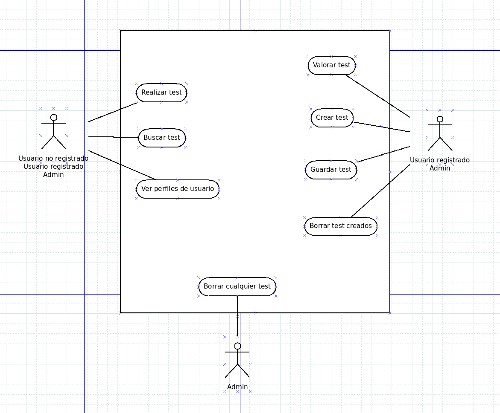  

### Pestaña de realizar test
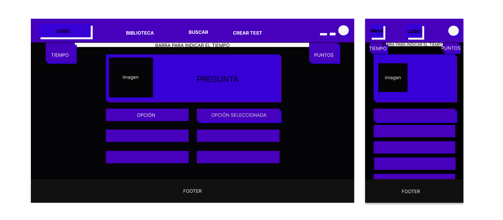  

### Pestaña de valoración y resumen
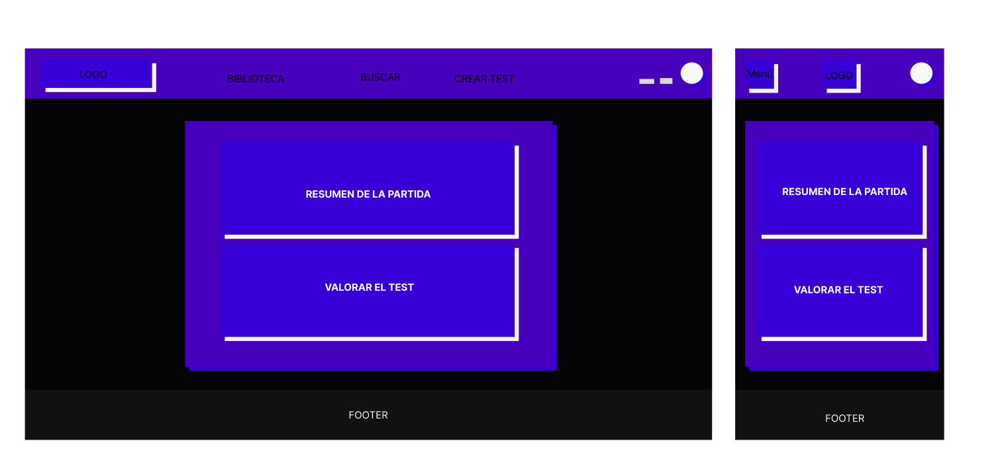  

### Pestaña de registro
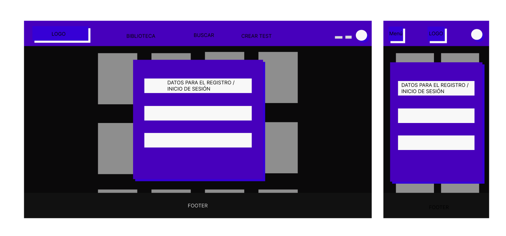  

### Pestaña de usuario
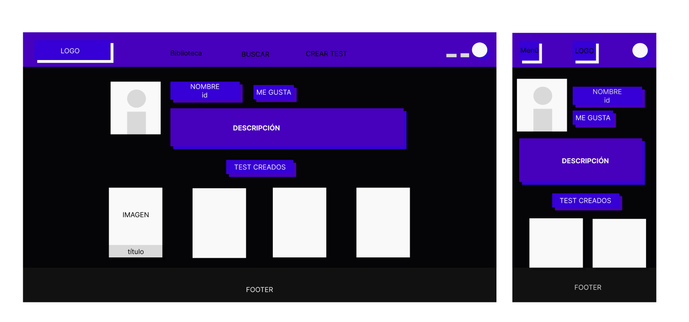  

### Pestaña de biblioteca
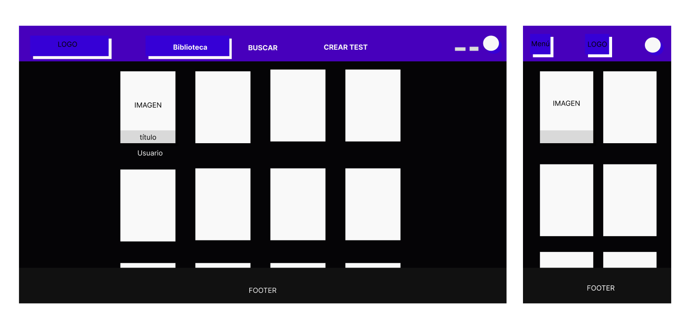  

### Pestaña de buscar
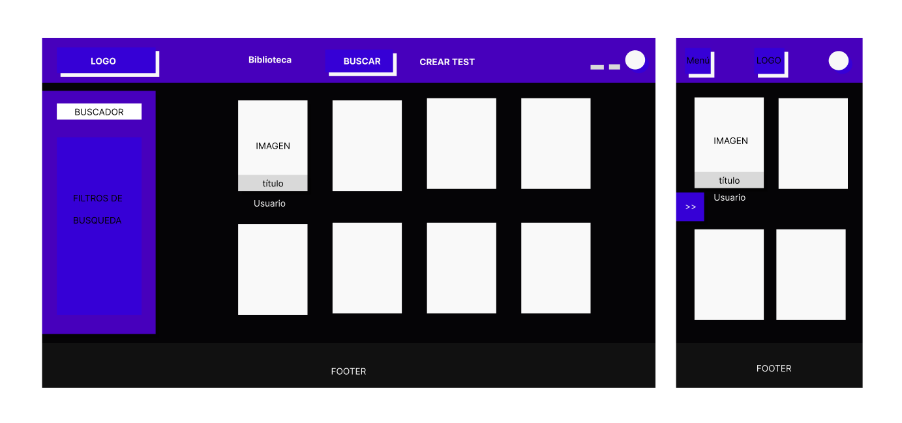  

### Pestaña de información detallada
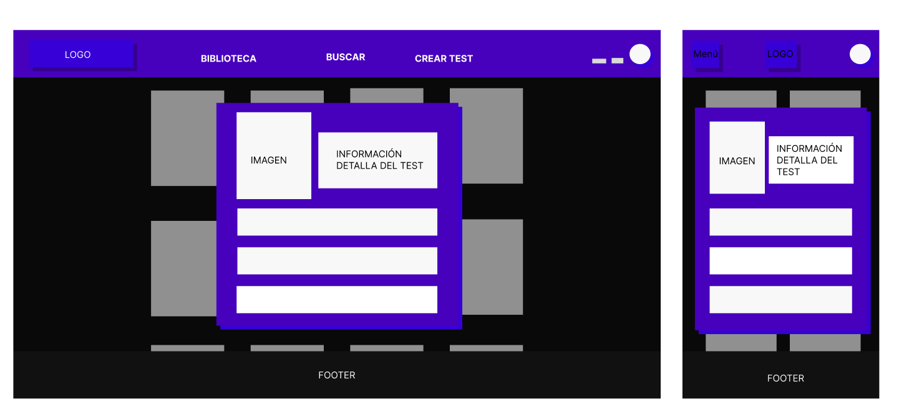  

### Pestaña de crear test
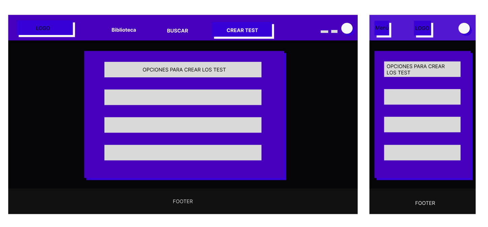  

### Diagrama de navegación de ventanas
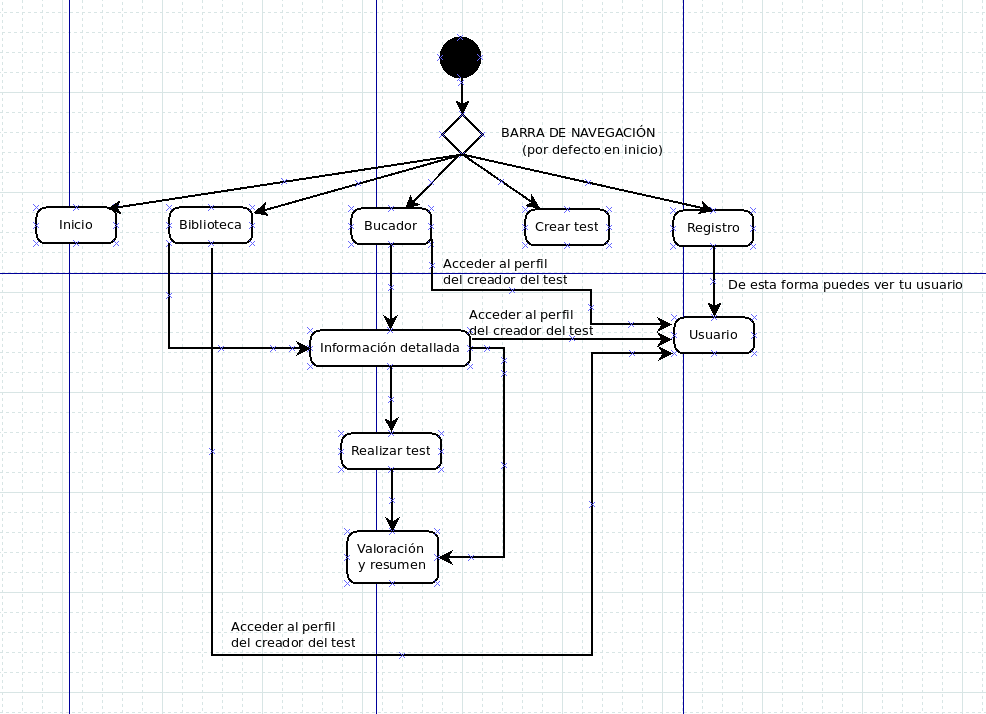  

### Diagrama de la base de datos
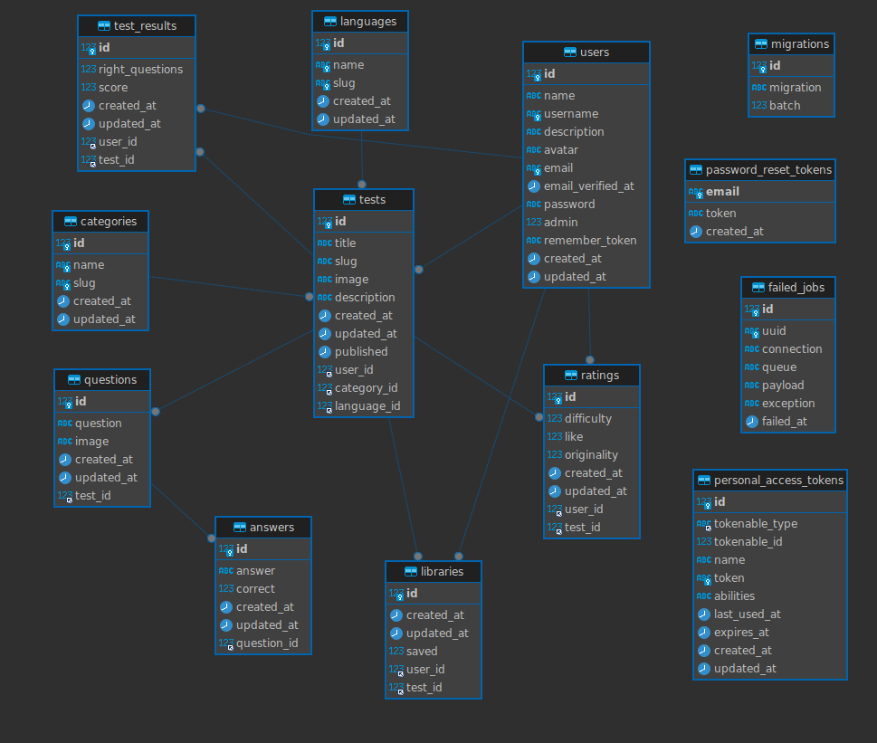  

### Diagrama de componentes de software
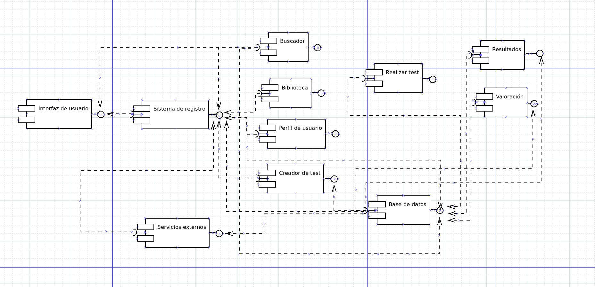  

### Diagrama de despliegue
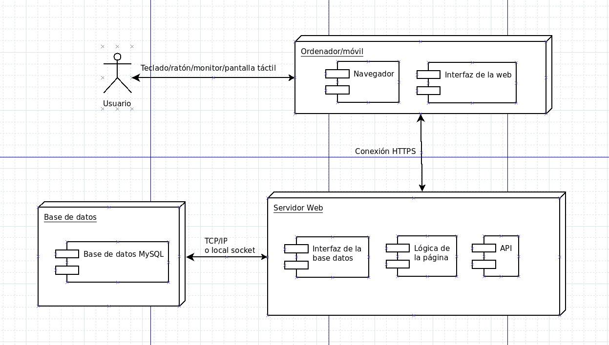  
